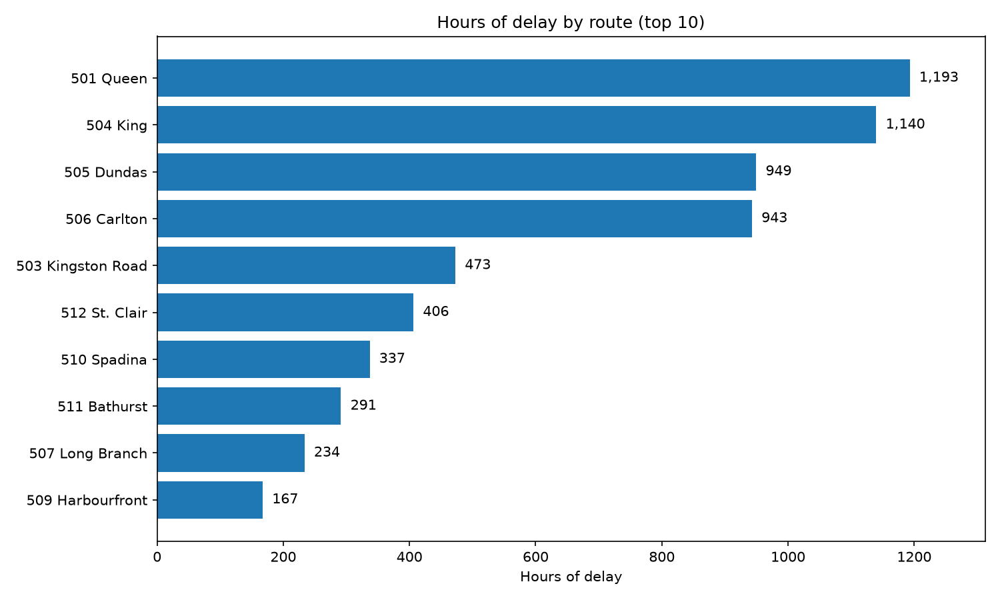
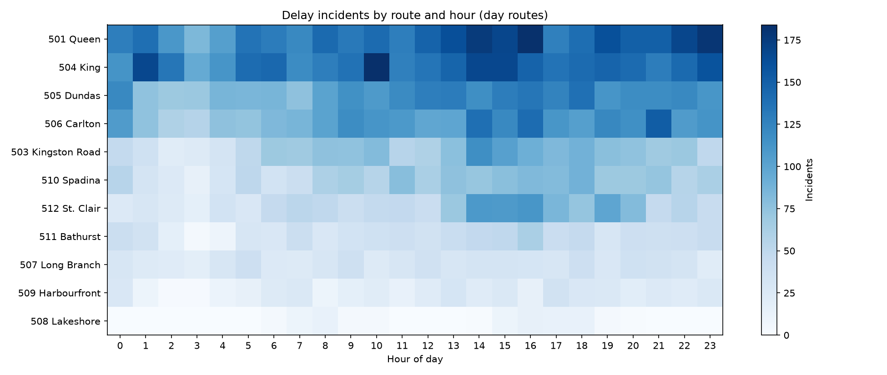

# TTC Streetcar Delay Analysis (Python + SQL)

Analysis of 19,000+ Toronto streetcar delays (Jan 2025 to Sep 2026) to find which routes, times, locations and causes cost riders the most time.

**Used both Pandas and SQL** throughout, and verified that key results match

**Data:** [TTC Streetcar Delay Data](https://open.toronto.ca/dataset/ttc-streetcar-delay-data/), City of Toronto Open Data

I also built a Power BI dashboard on the same dataset. This project repeats the analysis in Python and SQL.

## Key insights

- **4 routes cause 65% of all lost time:** 501 Queen, 504 King, 505 Dundas and 506 Carlton.
- **Delays peak from 2 to 5 PM,** not during the morning rush.
- **Overnight delays are rarer but last the longest** (23.4 min average vs 17.3 in the AM rush).
- **5 of 138 incident codes cause half of all lost minutes.** Code MTDV alone is 23.5%.
- **Hotspots are stations and loops** (Broadview, Dundas West, Humber Loop), pointing to turnaround and crew-change issues.
- **Improving:** Jan to Sep 2026 had 6.2% fewer incidents and 9.9% fewer minutes lost than the same months in 2025.
- **February 2025 snowstorms** caused about 1.7x a normal month's delays, concentrated on Feb 13 to 23.

## What I did

1. **Explored** the raw data: types, missing values, distributions
2. **Found data quality issues:** 204 spellings of route names, 999-minute placeholder delays, blank directions, duplicate rows
3. **Cleaned** the data using documented rules
4. **Created new features:** hour, month, time-of-day period, weekend flag, day/night service
5. **Answered each question in both Pandas and SQL** and checked the results match
6. **Investigated an outlier** (Feb 2025) using daily counts and news sources
7. **Wrote insights, recommendations and limitations**

### Cleaning decisions

| Problem | Decision |
|---|---|
| Non-route values in Line (RAD CAR, 929, etc.) | Kept only streetcar routes 501-512 and 301-312 |
| Inconsistent route names | Used the most common spelling per route number |
| Delays of 0 min | Kept for incident counts, excluded from delay averages |
| Delays over 300 min (e.g. 999) | Excluded from delay analysis as likely placeholders |
| Missing or invalid direction | Set to "Unknown" |
| 20 duplicate rows | Removed |

### Skills used

**Pandas:** groupby/agg, pivot_table, pd.cut, regex with str.extract, map, reindex, cumsum (Pareto)
**SQL:** GROUP BY / HAVING, CASE WHEN, CTEs, window functions (LAG, RANK, SUM OVER)

## Limitations

- Incident codes are abbreviations. Joining the TTC code lookup table would add descriptions.
- Locations show where a delay was recorded, not always where it started.

## How to run

pip install pandas matplotlib jupyter

Then open `my_analysis.ipynb` and click Run All.
